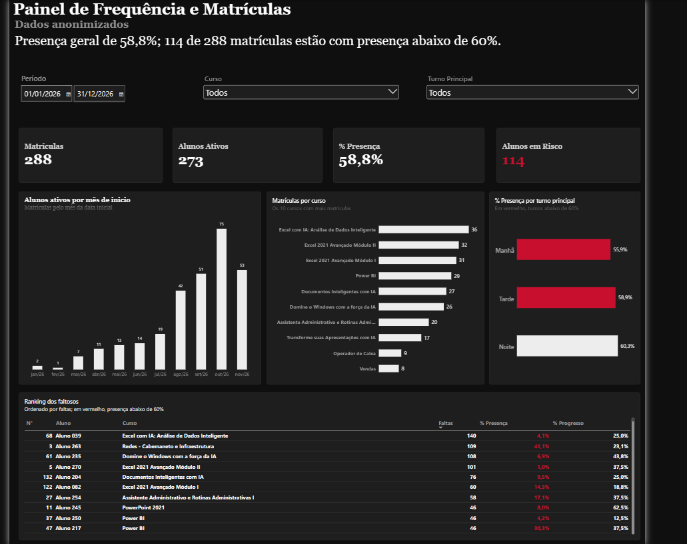

# Painel de Frequência e Matrículas | Power BI

Dashboard em Power BI para acompanhar matrículas, frequência e alunos em risco de evasão em uma escola de cursos profissionalizantes. Os dados são reais e foram **anonimizados**: os nomes dos alunos foram substituídos por códigos (Aluno 001, Aluno 002...).



## Contexto

Atuo como instrutor de Power BI e Excel em uma escola de cursos profissionalizantes e, desde 08/2026, sou responsável pelos relatórios gerenciais entregues semanalmente à direção. As informações de matrículas e frequência ficavam em relatórios separados por período, o que dificultava enxergar o ano completo e identificar rapidamente quem precisava de atenção.

Este painel consolida três extrações do sistema da escola (janeiro a abril, maio a julho e agosto a novembro de 2026) e responde a três perguntas:

1. **Volume:** quantos alunos temos e em quais cursos?
2. **Saúde:** como está a presença e em qual turno ela cai?
3. **Ação:** quais alunos a equipe deve procurar agora?

## Principais números (jan a nov/2026)

| Indicador | Valor |
|---|---|
| Matrículas | 288 |
| Alunos ativos | 273 |
| Presença geral | 58,8% |
| Matrículas com presença abaixo de 60% | 114 |

- Os cursos com mais matrículas são Excel com IA (36), Excel Avançado Módulo II (32) e Módulo I (31).
- A presença é menor no turno da manhã (55,9%) e maior à noite (60,3%).
- O ranking de faltosos aponta diretamente os alunos para contato da equipe.

## Como foi construído

**Preparação dos dados (Python e Power Query)**
- Consolidação das três bases em um único arquivo, com a coluna `Base` indicando o período de origem.
- Anonimização com códigos consistentes: o mesmo aluno mantém o mesmo código em todas as bases.
- Separação do nome do curso do código interno e conversão do tempo decorrido para número de dias.
- Colunas derivadas no Power Query: `Mês Início` e `Turno Principal` (primeiro turno contratado).
- Tabela Calendário relacionada à data de início, usada no filtro de período.

**Medidas em DAX**
```DAX
Matrículas = COUNTROWS(Alunos)
Alunos Ativos = DISTINCTCOUNT(Alunos[Nome Aluno])
Total Presenças = SUM(Alunos[Presencas])
Total Faltas = SUM(Alunos[Faltas])
% Presença = DIVIDE([Total Presenças], [Total Presenças] + [Total Faltas])
% Progresso = DIVIDE(SUM(Alunos[Aula Atual]), SUM(Alunos[Qtd Aulas]))
Alunos em Risco =
    COUNTROWS(
        FILTER(Alunos, DIVIDE(Alunos[Presencas], Alunos[Presencas] + Alunos[Faltas]) < 0.6)
    )
```

**Visualizações**
- Cartões de KPI com o resumo do período.
- Colunas de alunos por mês de início.
- Top 10 cursos por matrículas.
- Presença por turno, com destaque em vermelho para turnos abaixo de 60%.
- Ranking de faltosos com formatação condicional e progresso no curso.

## Limitações e cuidados

- **Contagem de presenças e faltas:** em vários registros a soma de presenças e faltas passa do número de aulas do curso, o que indica que o sistema conta por horário de aula. Por isso, os percentuais devem ser lidos como proporção entre registros de presença e falta.
- **Volume por mês:** o número menor de alunos nos primeiros meses pode refletir alunos que já concluíram e não aparecem na extração. Por isso, o gráfico usa o título neutro "alunos ativos por mês de início" em vez de "crescimento de matrículas".
- **Critério de risco:** o limite de 60% de presença é uma referência adotada para priorizar contatos e pode ser ajustado.

## Estrutura do repositório

```
painel-frequencia-matriculas/
├── README.md
├── imagens/
│   └── dashboard.png
├── dados/
│   └── Base_Alunos_Consolidada_Anonimizada.xlsx
└── powerbi/
    └── (arquivo .pbix)
```

## Ferramentas

Power BI · Power Query (M) · DAX · Python (Pandas) · Excel

## Autor

Rafael Machado Jeziorny | [LinkedIn](https://linkedin.com/in/rafael-machado-62332b239) | [GitHub](https://github.com/Rafaelmjmj)
